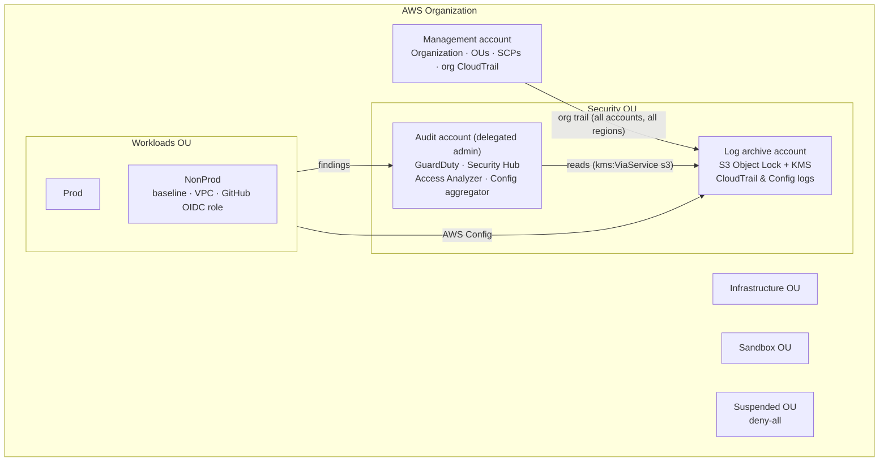

# terraform-aws-secure-landing-zone

[](https://github.com/Z-mac-debug/terraform-aws-secure-landing-zone/actions/workflows/terraform.yml)

A multi-account AWS landing zone in Terraform, built the way a regulated
organisation (bank, insurer, public sector) needs it. **Preventive guardrails**
stop risky changes before they happen. **Detective controls** run organisation-wide
from a dedicated security account, and every API call and configuration change
lands in an **immutable, encrypted log archive** that workload owners can't touch.

It's a lightweight, fully readable alternative to Control Tower / Landing Zone
Accelerator: every control is plain Terraform you can review in a pull request.

## Architecture



## Controls

| Layer | Control | Where |
|---|---|---|
| **Preventive (SCPs)** | Accounts can't leave the organisation; the root user is blocked | `modules/guardrails`, root |
| | CloudTrail, Config, GuardDuty, Security Hub and Access Analyzer can't be disabled or altered | root |
| | EBS encryption, S3 / snapshot / AMI public-access blocks and IMDS defaults can't be switched off | root |
| | `ec2:RunInstances` denied unless IMDSv2 is required | root |
| | Regional services limited to approved regions (default `eu-west-2`, `eu-west-1`) | root |
| | No IAM users, passwords or access keys in workload accounts (SSO and roles only) | Workloads OU |
| | Deny everything for quarantined accounts | Suspended OU |
| **Detective** | GuardDuty with S3, EBS malware, RDS login and Lambda network protection, auto-enabled for all accounts | `modules/security-tooling` |
| | Security Hub with AWS Foundational Security Best Practices + CIS v3.0, findings aggregated across regions | audit account |
| | IAM Access Analyzer across the whole organisation (external access) | audit account |
| | AWS Config in every account and region, with an organisation-wide aggregator | `modules/account-baseline` |
| **Logging** | One multi-region organisation trail with log-file validation and Insights | `modules/org-cloudtrail` |
| | Archive bucket: S3 Object Lock (write-once), SSE-KMS with key rotation, TLS-only, access-logged, tiered to Glacier IR | `modules/log-archive` |
| **Account baseline** | 14-character password policy, EBS encryption by default, IMDSv2 by default, S3 / snapshot / AMI public access blocked | `modules/account-baseline` |
| **Network** | Multi-AZ VPC, no auto-assigned public IPs, default security group stripped, KMS-encrypted flow logs kept for 1 year, private S3 gateway endpoint | `modules/network` |
| **CI/CD identity** | GitHub Actions → AWS via OIDC: short-lived credentials, trust restricted to one repository and branch/environment | `modules/github-oidc` |

The audit account, not the management account, runs the security tooling.
SCPs don't apply to the management account, so it should do as little as
possible.

## Repository layout

```
modules/
  organization/       # org, OUs, log-archive + audit accounts, delegated admins
  guardrails/         # service control policies + attachments
  log-archive/        # Object Lock bucket, access-log bucket, KMS key, bucket policies
  org-cloudtrail/     # organisation trail
  security-tooling/   # GuardDuty, Security Hub, Access Analyzer, Config aggregator
  account-baseline/   # per-account (and per-region) hardening + AWS Config recorder
  network/            # hardened VPC with flow logs
  github-oidc/        # keyless CI/CD role
environments/         # one root module per account, each with its own state
  management/  log-archive/  audit/  workload/
```

## Deployment order

Each environment has its own state file (S3 backend with native locking), so a
mistake in a workload can never touch the organisation itself. Outputs from
each step feed the next one's `terraform.tfvars`.

| # | Environment | Credentials | Produces |
|---|---|---|---|
| 1 | `management` (first run) | management account | organisation, OUs, accounts, SCPs |
| 2 | `log-archive` | assumes `OrganizationAccountAccessRole` | archive bucket + KMS key |
| 3 | `management` (second run, with archive outputs) | management account | org trail + baseline |
| 4 | `audit` | assumes role into audit | GuardDuty, Security Hub, Access Analyzer, Config aggregator |
| 5 | `workload` (per account) | assumes role into workload | baseline in both regions, VPC, deploy role |

```bash
cd environments/management
cp terraform.tfvars.example terraform.tfvars        # fill in
cp backend.hcl.example backend.hcl                  # your state bucket
terraform init -backend-config=backend.hcl
terraform plan -out=tfplan && terraform apply tfplan
```

> **Cost:** GuardDuty, Security Hub, Config, NAT gateways and KMS keys all have
> running costs. Use a dedicated test organisation, and `terraform destroy`
> workload environments when you're done. The core accounts and archive bucket
> are protected by `prevent_destroy` and Object Lock on purpose.

## CI pipeline

Every push and pull request runs five gates. None of them need AWS credentials.

| Job | Tool | Checks |
|---|---|---|
| Secrets | Gitleaks | no credentials anywhere in git history |
| Format & validate | `terraform fmt` / `validate` | formatting, and every module and environment initialises and validates |
| Lint | TFLint + AWS ruleset | deprecated syntax, unused declarations, naming, AWS-specific errors |
| Policy as code | Checkov | hundreds of AWS security best-practice checks on the Terraform and the workflow |
| Misconfiguration | Trivy | a second, independent misconfiguration engine (HIGH/CRITICAL fail the build) |

Actions are pinned to commit SHAs and updated by Dependabot with a 7-day cooldown.
Accepted risks are documented inline as `#checkov:skip=<ID>:<reason>` or
`#trivy:ignore:<ID>`, so each exception is visible and reviewable in the code.

The same checks run locally with `pre-commit install`.

## Design decisions

- **State isolation per account.** Separate root modules and state files limit
  the blast radius and allow different approvers per environment.
- **Write-once logs.** Object Lock (GOVERNANCE by default, COMPLIANCE
  optional) means even an administrator with stolen credentials can't erase
  the audit trail inside the retention window.
- **Labelled, not ID-keyed, `for_each`.** SCP attachments are keyed by label
  (`baseline:root`), so the first apply works before any OU IDs exist.
- **Regional controls in every approved region.** Config, EBS encryption and
  IMDS defaults are regional, so the workload environment applies the baseline
  to both regions. Account-wide settings (password policy, S3 account block)
  are managed once, from the home region.
- **SCP exemptions are explicit.** Protective statements exempt only the role
  patterns in `exempt_role_arns` (the pipeline and break-glass roles).

## Roadmap

- IAM Identity Center permission sets and group assignments
- Account vending: new workload accounts from a single module call
- Centralised networking: Transit Gateway, inspection VPC, Route 53 Resolver
- `plan` on pull requests through the GitHub OIDC role
- Cross-region replication of the log archive
- Tag policies and AWS Backup policies
